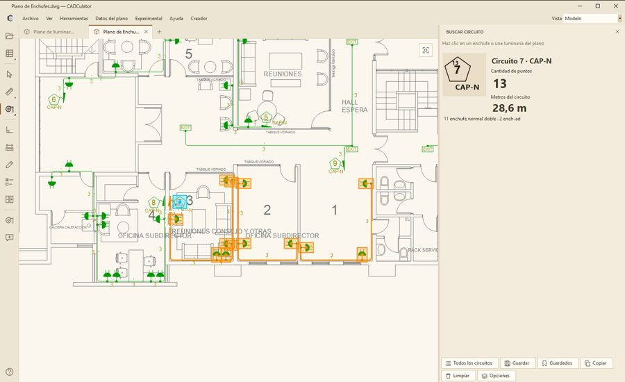
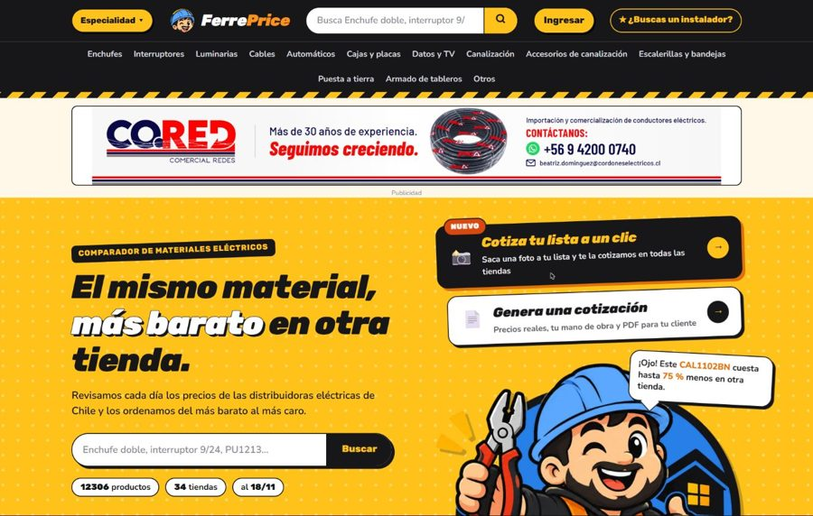
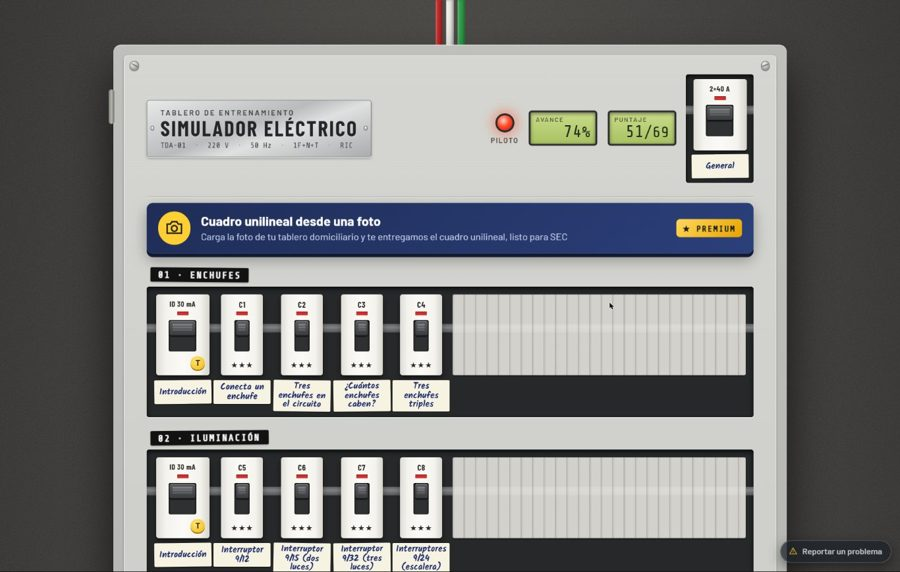
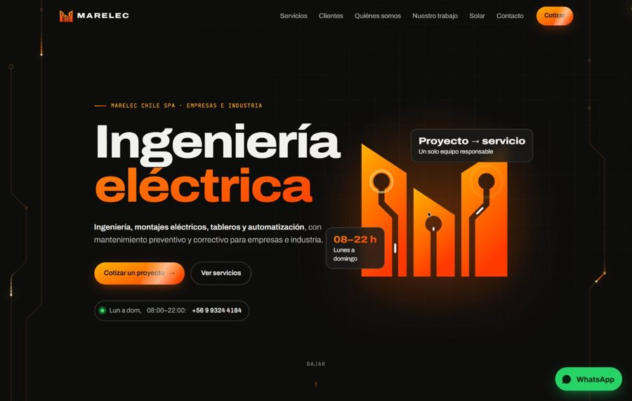
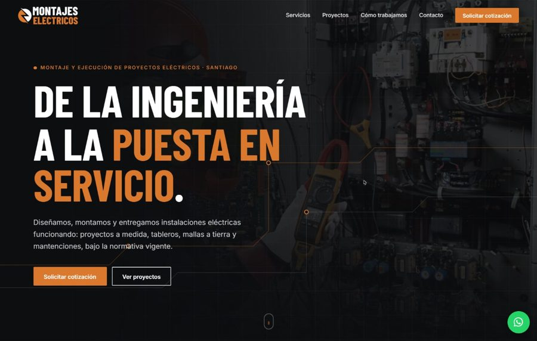

# Bladimir López

**Ingeniero en Informática y desarrollador de software .NET.** Fundador de **Terreno Digital SpA**.

Antes de programar pasé 10 años en el rubro eléctrico, y eso cambió mi forma de construir software: parto del problema real de quien lo va a usar. Hoy desarrollo y mantengo productos propios en producción, con usuarios y pagos reales, y sitios para empresas.

        

---

## Productos propios en producción

### [CADCulator](https://cadculator.cl) · software para planos eléctricos
Lee planos DWG, DXF y PDF y cubica instalaciones eléctricas: cuenta símbolos, sigue circuitos y calcula metros. Programa para PC, app Android y sitio web con cuentas, suscripciones y pago en línea.
`C#` `.NET` `Windows Forms` `Android` `ASP.NET Core` `SQLite` `Docker` · [Ver ficha del proyecto](https://github.com/lopezgalarce1997-debug/CADCulator-Portfolio)

### [FerrePrice](https://ferreprice.cl) · comparador de precios de materiales eléctricos
Más de 12.000 productos de 34 tiendas de Chile, actualizados cada día y ordenados del más barato al más caro. Cotizaciones en PDF para instaladores, cotización de listas desde una foto y suscripciones con pago en línea.
`C#` `.NET 10` `ASP.NET Core` `Razor Pages` `SQLite` `Docker` · [Ver ficha del proyecto](https://github.com/lopezgalarce1997-debug/FerrePrice-Portfolio)

### [Simulador Eléctrico](https://cadculator.cl) · entrenamiento para la licencia SEC
Tablero interactivo con niveles de enchufes, iluminación, comandos de motores y tableros: se conectan cables y se prueban los circuitos. Pistas, guía paso a paso, revisión según la norma RIC y cuadro unilineal en DWG desde una foto del tablero. Plan de pago dentro de cadculator.cl.
`JavaScript` `SVG` `ASP.NET Core` `DWG`

---

## Sitios para clientes

| [MARELEC](https://marelecspa.cl) | [Montajes Eléctricos](https://montajeselectricos.cl) |
|---|---|
|  |  |
| Empresa de ingeniería eléctrica: diseño a medida, calculadora solar y panel con inicio de sesión para que el cliente suba sus trabajos. | Rediseño completo con entrada animada, galería de obras y migración de dominio y correo sin cortes. |

---

## Infraestructura propia

Servidor VPS con **Docker** y **Dokploy** donde corren mis productos y sitios de clientes: cada sitio separado, https automático con Traefik y despliegue continuo desde GitHub.

---

## Otros proyectos

| Proyecto | Qué es | Tecnologías |
|---|---|---|
| [FormaLista](https://github.com/lopezgalarce1997-debug/FormaLista) | Creador de formularios y encuestas, con 455 pruebas automatizadas | TypeScript, Node.js, React, MySQL, MongoDB |
| [NoCaigo](https://github.com/lopezgalarce1997-debug/NoCaigo) | API REST que detecta estafas en mensajes combinando reglas e IA | C#, ASP.NET Core, SQL Server |
| [LoLSitio](https://github.com/lopezgalarce1997-debug/LoLSitio) | Estadísticas de League of Legends y app de escritorio | C#, Blazor, WPF, SQLite |
| [Gestión Total](https://github.com/lopezgalarce1997-debug/Gestion-Total) | Software comercial de escritorio para obras, inventario y nómina (ficha del proyecto) | C#, .NET 8, WPF, SQLite |

CADCulator, FerrePrice y Gestión Total son productos propietarios: sus repositorios muestran el proyecto, no el código fuente.

## Contacto

[Portafolio](https://www.bladimir-lopez.com) · [LinkedIn](https://www.linkedin.com/in/bladimirlopez) · [CADCulator](https://cadculator.cl) · [FerrePrice](https://ferreprice.cl)

© 2026 Bladimir López · Terreno Digital SpA. Las capturas, textos y marcas de este perfil tienen todos los derechos reservados; no se autoriza su copia ni reutilización.
